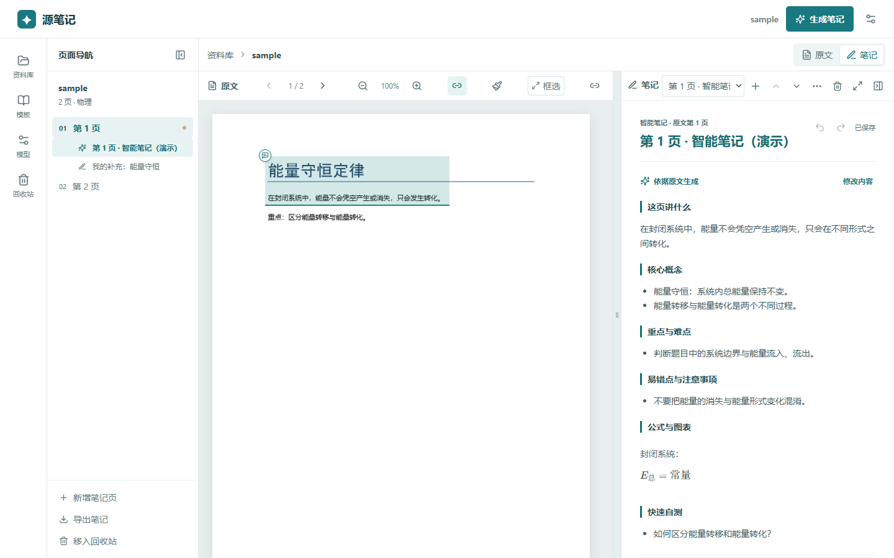
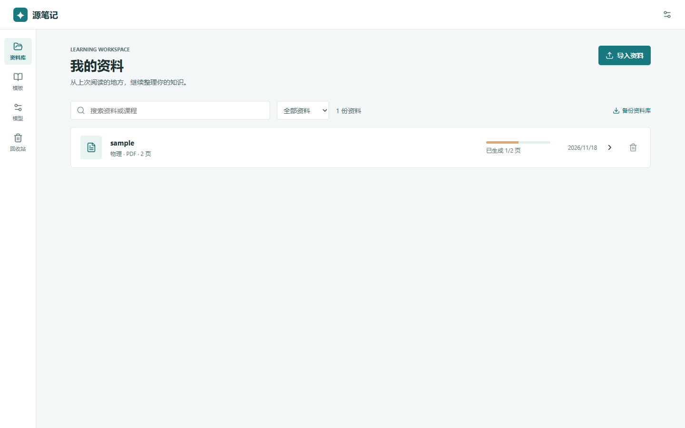
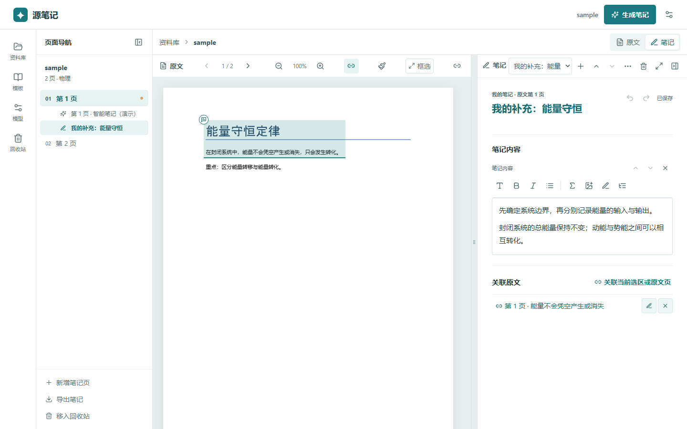
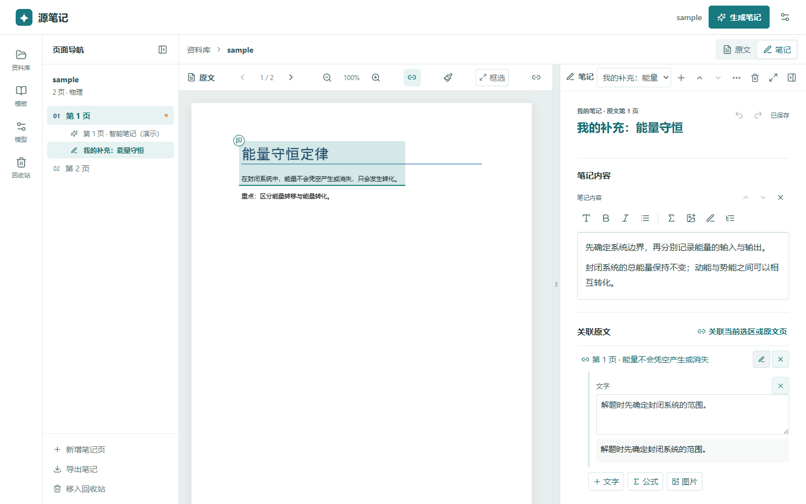
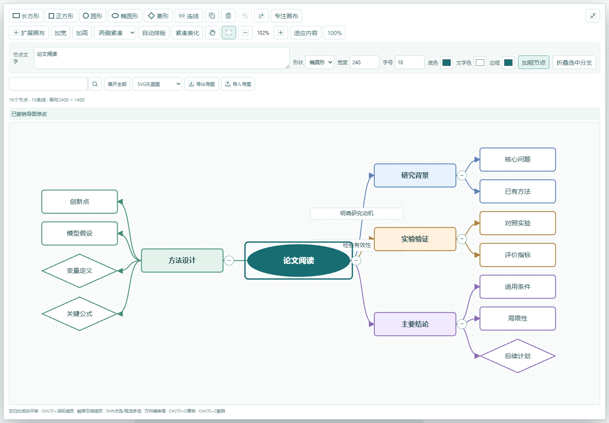
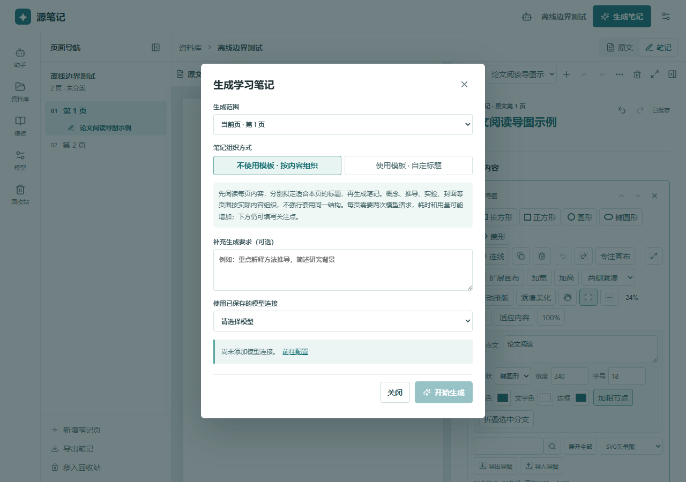
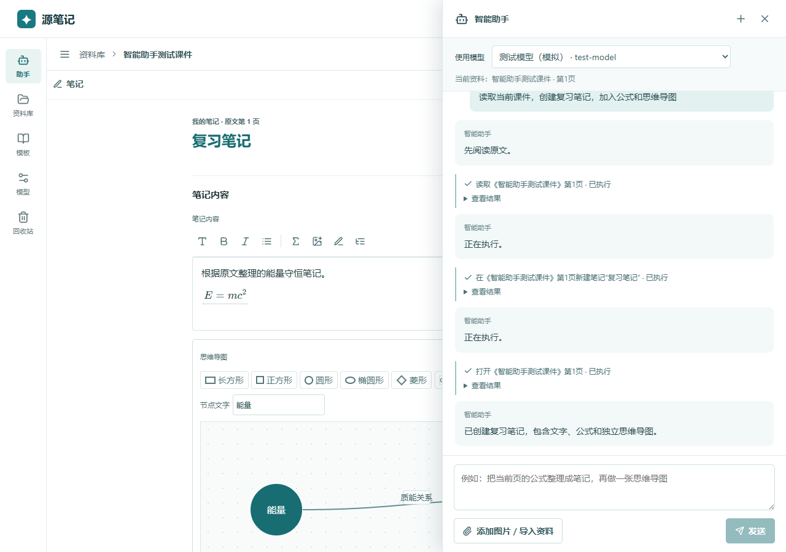

# 源笔记 · Yuan Notes

**把课件、论文、原文批注和学习笔记放在一起。** 源笔记是一款公开源码的学习笔记应用，面向学生、论文阅读者和自学者，支持 Windows 电脑、Android 手机和平板，以及自行运行的网页版。

你可以导入资料，边读原文边记笔记，在同一个编辑区编写文字、公式和图片，再用手写、思维导图、画笔和便利贴整理理解。需要智能整理时，可接入自己的大模型 API，让模型按页生成笔记，或用一句指令让智能助手操作资料和笔记。

**阅读和手动记笔记不需要模型账号。智能生成与智能助手需要联网，并由你自行配置 API。**

[下载安装](#下载与安装) · [第一次使用](#第一次使用) · [全部功能](#功能介绍) · [图文教程](docs/使用指南.md) · [常见问题](docs/常见问题与注意事项.md) · [源代码运行](#从源码运行网页版)



> 当前提供的是预览/测试版本：Windows **0.3.5**，Android **0.4.5-offline**。**尚无官方公共网页版网址、iOS 安装包或应用商店版本。** GitHub 页面用于介绍项目、下载软件和获取源码；下载页中的 “Source code” 压缩包不是安装包。

## 下载与安装

### 选择版本

| 使用设备 | 下载或运行入口 | 支持导入 | 使用条件 |
| --- | --- | --- | --- |
| Windows 10/11 x64 电脑 | [下载安装包 .exe](https://github.com/kaituozher11-png/yuan-notes/releases/download/preview-2026-11-28-note-continuation/YuanNotes-Windows-Setup-0.3.5.exe) | PDF、Word/DOCX、PPT/PPTX；单文件不超过 100 MB | 另装 Poppler；Word/PPT 还需转换工具，见下文 |
| Android 8.0 及以上手机、平板 | [下载离线测试 APK](https://github.com/kaituozher11-png/yuan-notes/releases/download/preview-2026-11-28-note-continuation/YuanNotes-Android-offline-0.4.5.apk) | PDF；单文件不超过 100 MB | 本地阅读和编辑无需连接电脑或同一 Wi-Fi |
| 本机网页版 | [按源码运行步骤启动](#从源码运行网页版) | 与桌面服务相同 | Node.js 24+；浏览器打开本机地址，服务需保持运行 |
| 自行部署的多用户网页版 | [部署说明](docs/网页版部署说明.md) | 由服务器提供文档转换 | 需要自行配置服务器和 HTTPS，当前没有官方托管服务 |

[完整发布页](https://github.com/kaituozher11-png/yuan-notes/releases/tag/preview-2026-11-28-note-continuation)包含 Windows 安装包、Android APK 和 SHA256 校验文件。[全部历史版本](https://github.com/kaituozher11-png/yuan-notes/releases)可用于查看更新记录。macOS、Linux 和 iOS 暂未提供安装包。

### Windows 安装

1. 下载 `YuanNotes-Windows-Setup-0.3.5.exe`，运行安装程序并选择安装位置。安装后从开始菜单打开“源笔记”。普通用户使用安装包不需要先装 Node.js。
2. 安装 [Poppler for Windows](https://github.com/oschwartz10612/poppler-windows/releases)，把含 `pdfinfo.exe`、`pdftotext.exe`、`pdftoppm.exe` 的文件夹加入用户 `Path`，再重新打开源笔记。这是第三方维护的 Windows 发行版；本项目没有内置这些工具。
3. 导入 Word/PPT 时，再安装 [LibreOffice](https://www.libreoffice.org/download/download-libreoffice/)，确保 `soffice.com` 可用。Windows 的 Word 文档还会优先尝试使用已安装的 Microsoft Word；PDF 不需要安装 Office。
4. 先导入一份小 PDF 检查翻页、图片和保存；复杂 Word、MathType 公式或课件建议先自行导出 PDF，检查无误后导入。

安装包尚未数字签名，Windows 可能提示来源未知。请核对本仓库的发布地址及校验值，不需要全局关闭系统防护。工具配置的图文步骤见[安装教程](docs/使用指南.md#windows-安装与工具配置)。

### Android 安装

1. 下载 `YuanNotes-Android-offline-0.4.5.apk`，在手机或平板的文件管理器中点击安装。系统询问时，为本次使用的浏览器或文件管理器允许安装此来源的应用。
2. 打开源笔记即可导入 PDF 和记笔记，不需要连接电脑、输入电脑地址或加入特定 Wi-Fi。Word/PPT 请先转换为 PDF。
3. 从本项目旧测试版升级时，**先备份，再覆盖安装**。当前 APK 沿用测试签名；若提示无法安装，先核对设备版本和已有应用来源，切勿为尝试安装而直接卸载含有重要资料的旧版。

APK 是测试构建，尚未在所有厂商设备和实体平板上验证。Android 卸载、清除数据可能删除本地资料；备份 ZIP 应另存到应用外的可靠位置。

## 第一次使用

1. **导入资料**：资料库 → 导入资料，一次选择一个或多个文件；可填写课程并选择文件夹。
2. **打开原文**：点击资料，使用页码导航、翻页和缩放阅读。点击“原文”集中阅读，点击“笔记”展开侧栏。
3. **写个人笔记**：在笔记栏新增一页，选择自由笔记或模板，在同一编辑区输入文字、插入公式和图片；按需添加手写区或独立思维导图。
4. **连接知识与出处**：选中文字或框选原文区域，将它关联到当前笔记，添加文字、公式、图片批注；也可直接用画笔和便利贴标记原文。
5. **选择是否使用 AI**：到“模型”保存并测试自己的接口，回到资料点击“生成笔记”，或打开“助手”输入要求。
6. **保存与备份**：编辑会自动保存；若出现保存失败提示，请先处理再退出。资料库可下载 ZIP 备份，资料页可导出 HTML 笔记。

完整步骤和截图见[安装与使用指南](docs/使用指南.md)。

## 功能介绍

### 资料库与阅读

- **批量导入**：电脑和网页版可选择多份 PDF、Word、PPT；Android 可选择多份 PDF。逐份处理，某份失败时已成功导入的资料保留。
- **文件夹与课程**：新建文件夹、在文件夹中导入、移动资料、重命名；按课程、文件名和笔记关键词查找，筛选未生成完的资料或个人笔记。
- **原文阅读**：按页导航、翻页、缩放，选择并复制带文字层的 PDF 内容。扫描页能否选择文字取决于文件本身，不附带通用 OCR。
- **阅读布局**：原文单独显示、笔记侧栏、笔记最大化；可调整两栏宽度。手机和平板按屏幕尺寸调整布局。
- **资料管理**：删除资料先移入回收站，支持恢复；删除文件夹前需要先移出其中资料。



### 个人笔记、公式、图片与手写

- **统一编辑**：文字、公式和图片在同一个编辑区共同排版，支持加粗、斜体和列表；不是分别填写三套独立内容框。
- **公式编辑**：提供可视化数学输入、LaTeX、分数、上下标、根号、积分、求和、矩阵等结构。公式工具在正文编辑区外展开，正文保留排版后的公式。它不等于内置 Microsoft Word 或 MathType。
- **图片插入**：选择图片、粘贴剪贴板图片或拖入图片；可调整宽度和左/中/右位置，文字可在左右对齐的图片旁排版。支持 PNG/JPEG/GIF/WebP，单张不超过 5 MB。
- **手写区域**：画笔、荧光笔、橡皮擦、颜色、粗细、撤销上一笔；加号扩展书写区域。
- **笔记页管理**：同一原文页可有多份笔记，支持标题编辑、复制、排序、删除和恢复；保留个人补充和智能笔记的区分。
- **模板**：自定义笔记标题、顺序、强调色及普通/方格/横线纸张，用于新建笔记。个人模板与 AI 的生成标题是不同设置。



### 原文关联、批注、画笔与便利贴

- **双向关联**：关联整页、选中文字或框选区域，从笔记回到原文位置，也能从原文关联位置查看笔记和批注。
- **混合批注**：批注可组合文字、公式和图片；电脑端悬停可查看，触屏可点击关联位置。
- **框选调整**：可移动、调整选框大小，或取消不需要的选区。
- **原文标记**：直接在原文上使用画笔、荧光笔、橡皮擦。
- **便利贴**：单个放置或连续批量放置，可编辑、移动、删除；隐藏后只保留小型空心萤火虫标记，标记仍可拖动，点击后展开内容。



### 思维导图

使用独立画布整理概念、方法与关系，适合论文梳理、章节复习和知识网络。

- 画布可加宽、加高，支持全屏、专注模式、平移、缩放、适应内容和双指缩放。
- 长方形、正方形、圆形、椭圆形、菱形节点；文字自动换行，可设置宽度、字号、颜色和粗体。
- 节点自由连线，连线可写文字，支持曲线、直线、折线、箭头、虚线、颜色和粗细。
- 两侧紧凑、向右树形、向下树形、网格自动排版；支持多选、框选、成组移动、复制内部连线、撤销/重做、折叠和搜索。
- 完整导出 SVG、PNG、JSON，包括折叠内容；JSON 可重新导入继续编辑。

画布最大 32000 × 32000，JSON 导入最多 500 节点、1500 连线、2 MB。PNG 会限制像素以控制内存，超大图建议导出 SVG。节点内暂不提供结构化公式排版，也不支持直接导入 Xmind 等原生格式。详见[思维导图使用指南](docs/思维导图使用指南.md)。



### 智能生成笔记

复用已保存的模型连接，按当前页、指定页或整份资料逐页生成，可自行增加、减少、修改和排序标题，并填写补充生成要求。

| 预设 | 默认标题 |
| --- | --- |
| 课件笔记生成 | 本页内容概览、核心概念、重点与难点、公式与图表、易错点与注意事项、课后自测 |
| 论文笔记生成 | 研究问题与背景、核心方法、关键公式与图表、实验设计与结果、主要结论、局限与待思考问题 |

**不使用模板 · 按内容组织**：逐页先读取原文和可用图片，单独规划 1～8 个符合本页内容的标题，再按提纲生成。概念、推导、实验、封面等页面可用不同结构，不强制填背景/方法/实验/结论。每页通常两次模型请求，耗时与费用可能增加；相似页面允许采用相似标题，不为差异化编造内容。

**使用模板 · 自定标题**：选择上表预设，或自行增删改标题，按指定结构生成。

自定义标题为 1～12 个，每个不超过 60 字且不能重复；补充要求不超过 1000 字。每次重新生成都会新增独立编号版本（版本 1、版本 2……），旧笔记、个人补充和关联保留，可从笔记下拉框切换。生成后还能手动修改标题和正文。

内容依据所读页面生成；全篇“逐页生成”不等同于模型一次读完整篇论文。扫描页可尝试支持页面图片的模型；普通文本模型无法自动获得扫描图内容。



### 智能助手 Agent

输入目标，让助手逐步查找、读取和调用软件功能；当前提供 33 项具名操作，涵盖资料与文件夹、笔记与混合内容、生成与模板、原文批注和标记、便利贴、导图、阅读布局、复制、导出及备份。

例如：

- “新建一个论文文件夹，把当前资料移进去。”
- “用论文模板整理第 2～4 页，标题改为研究问题、方法和结论。”
- “把当前页的公式整理成个人笔记，并关联原文。”
- “给导图加一个圆形实验节点，在连线上写验证，向右自动排版。”
- “隐藏当前页的便利贴，然后导出这份资料的笔记。”

新建导图可只提供节点与关系，坐标由软件排版。回复格式错误会尝试结构化工具调用，继续任务带上失败原因，已成功写入不重复提交。

助手会显示执行记录，可停止；格式错误可自动尝试修复，失败后可在当前会话“继续任务”。修改已有内容等操作会要求确认，发现笔记已变化时阻止旧内容写入。需要选择文件、输入密钥或点击下载时，会交给用户完成。**打开某个工具入口不代表已自动完成该操作，也不能保证任意模型都能正确理解所有指令。**

助手未明确要求模板时采用按内容组织；制作导图先读取指定范围，按知识逻辑梳理短语和分支，新图自动应用紧凑布局及分支配色。已有图可点击“紧凑美化”，可撤销；不会自动重写旧笔记。

每轮最多执行 12 步，助手一次生成最多 10 页；长任务需要分批继续。对话断点和撤销历史不会跨应用重启保存。详见[智能助手使用指南](docs/智能助手使用指南.md)。



## 模型连接、费用与隐私

- 支持兼容 **OpenAI Chat Completions** 的接口。内置多厂商模型预设，可下拉选择或手填模型名称；预设会填写对应接口，也可改成自选服务商地址。
- 已保存连接每行提供删除按钮，无需先解锁；确认后移除本机配置和密钥缓存，保留资料与笔记，任务运行时暂时禁用。
- 保存多个连接，以保护口令加密保存密钥，使用时选择并解锁。口令至少 8 个字符；连接设置保存在当前设备或浏览器，**不随资料库备份导出**。
- 不附带模型账号、API 密钥或免费额度；调用和测试可能产生服务商费用。预设列表不保证你的账号具有全部模型权限。
- AI 会把请求需要的指令、资料文字、笔记、目录，以及启用时的页面图片发送给所选服务商。先确认资料适合发送给该服务商，不要把密钥、保护口令或私人材料写进公开 Issue。
- Android 模型连接需公网 HTTPS 接口；本机服务可连接本机模型接口，公开部署有额外地址限制。支持 OpenAI 兼容协议不代表支持所有服务商的独有 API。
- AI 可能遗漏、误解或生成错误内容，公式和结论应对照原文核对；用户仍需审核修改、删除和生成结果。

## 数据保存、备份与升级

| 使用方式 | 资料保存位置 | 模型设置 |
| --- | --- | --- |
| Windows 安装版 | 应用的本地用户数据目录；兼容早期数据目录 | 该客户端的浏览器存储，加密保存 |
| Android APK | 当前设备的应用本地存储 | 当前设备的应用存储，加密保存 |
| 本机源码网页版 | 默认项目 `data/`，可通过 `YINGXING_DATA_DIR` 修改 | 当前浏览器存储 |
| 自行部署的公开模式 | 服务器按账号隔离的资料库 | 当前浏览器按账号保存 |

**没有自动跨设备同步或实时多人协作。** Windows、Android 和单独启动的本机服务不会自动合并资料。浏览器版需服务运行；“本机地址”只指当前电脑，无法直接发给其他人使用。

- 资料库的 ZIP 备份包含资料、笔记等内容，不包含模型密钥；请将备份存到应用外。
- Android 提供 ZIP 恢复入口，**恢复会替换当前资料库**，不是合并。其他版本目前没有相同的一键恢复界面，不要把 ZIP 恢复当作通用同步方案。
- HTML 导出适合阅读或分享笔记，不是完整资料库备份；HTML、SVG 和 PNG 不能作为原始笔记导入，导图 JSON 是独立可编辑格式。
- 升级前先备份，Android 尽量覆盖安装；卸载、清除应用数据或浏览器站点数据会影响本地资料或模型设置。

## 从源码运行网页版

普通 Windows/Android 用户优先下载安装包。下面面向希望自己运行或参与开发的用户。

准备 Git、**Node.js 24+（含 npm）**。PDF 导入需要 Poppler；Word/PPT 转换还需要 LibreOffice，Windows Word 可使用 Microsoft Word。将外部工具加入 `Path` 后，在终端执行：

```powershell
git clone https://github.com/kaituozher11-png/yuan-notes.git
cd yuan-notes
npm ci
npm run build
npm start
```

在**同一台电脑**打开 <http://127.0.0.1:4174/>，保持终端中的服务运行。不要双击 `index.html` 或把 `dist/` 单独上传 GitHub Pages；网页版同时依赖后端文件处理和保存服务。

开发与检查：

```powershell
npm run dev     # 开发页面：http://127.0.0.1:5173/；API 服务默认 4174
npm test        # 自动测试
npm run build   # 生产网页构建
```

打包 Windows 可使用 `npm run desktop:installer`；Android 源码位于 `android/`，需要 JDK 与 Android SDK，先构建网页再运行 Gradle。构建输出和目录说明见[开发与项目结构](docs/项目结构与开发.md)。公开部署、账号模式及现有部署配置的限制见[网页版部署说明](docs/网页版部署说明.md)。

## 当前限制与验证状态

- 安装包是预览/测试版；没有自动更新，未提供应用商店和 iOS 版本。
- 文档转换无法保证复杂 Word、MathType 公式、编号或特殊字体完全复现；高保真需求建议先在原软件导出 PDF。
- 无通用 OCR；无原件 Word/PPT 编辑、自动云同步、实时协作、竞品导图原生格式兼容。
- Windows 安装包未在所有全新系统环境验收；手机/平板界面经过浏览器尺寸和触摸事件检查，不能替代实体设备测试。
- 当前功能版本有 **104 项自动测试通过**，完成浏览器、离线存储、备份恢复及打包 Windows 检查；AI 链路使用模拟服务验证，未据此承诺所有真实服务商表现一致。

详细检查范围见[本次验收记录](docs/自适应笔记与紧凑导图验收_2026-11-28.md)。遇到问题可先看[常见问题与注意事项](docs/常见问题与注意事项.md)。

## 文档与反馈

| 文档 | 内容 |
| --- | --- |
| [安装与使用指南](docs/使用指南.md) | 逐步安装、工具配置、阅读与全部功能教程 |
| [常见问题与注意事项](docs/常见问题与注意事项.md) | 导入、公式、联网、保存、升级和排错 |
| [智能助手指南](docs/智能助手使用指南.md) | 指令示例、确认、停止、继续任务与能力边界 |
| [思维导图指南](docs/思维导图使用指南.md) | 画布、布局、连线、快捷键、导入导出 |
| [项目介绍](docs/项目介绍/README.md) | 项目定位、使用场景和界面展示 |
| [版本说明](docs/预览版说明.md) | 当前安装包、版本及升级说明 |
| [项目结构与开发](docs/项目结构与开发.md) | 技术组成、运行命令、源码目录和构建 |
| [网页版部署说明](docs/网页版部署说明.md) | 自行部署与多用户模式，未提供官方服务 |

在 [GitHub Issues](https://github.com/kaituozher11-png/yuan-notes/issues) 提交问题或建议。请说明设备/系统、应用版本、文件类型、操作步骤、预期结果和实际情况，并附不含敏感信息的截图；可复现样例更有助于定位。不要公开 API 密钥、保护口令、登录密码或他人资料。

本页对应 Windows 0.3.5 / Android 0.4.5-offline；旧截图和归档材料的外观可能与当前版本不同，功能和安装说明以本页及当前 Markdown 指南为准。
