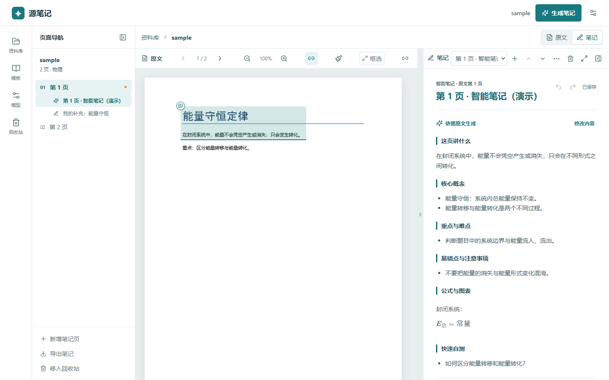
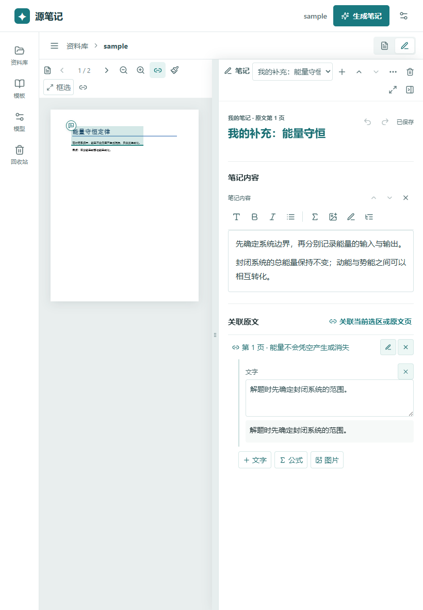
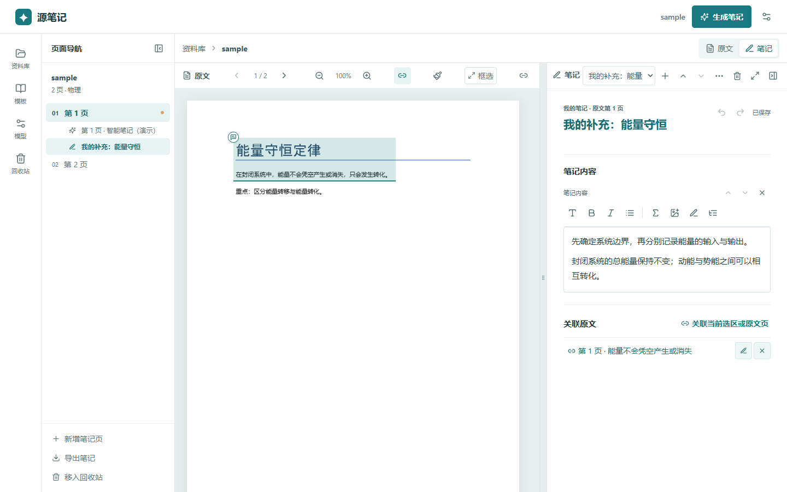
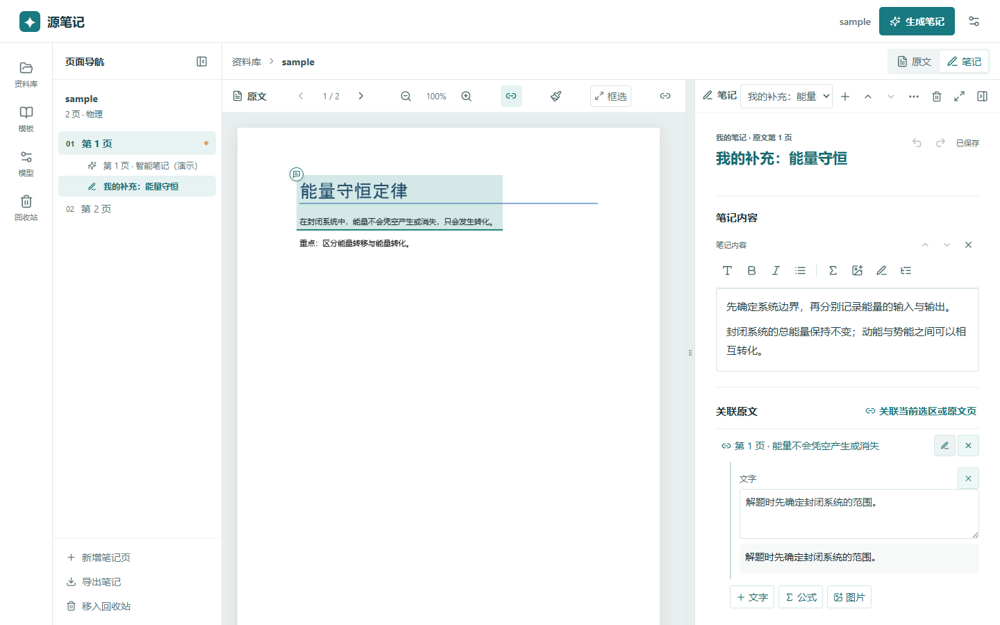
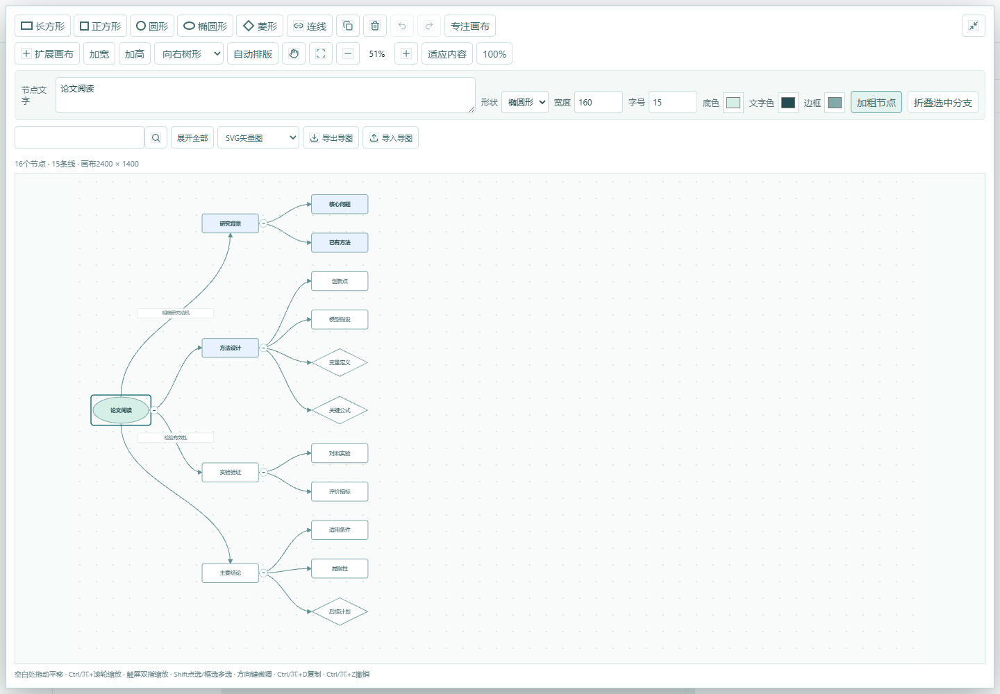

# 源笔记安装与使用指南

适用于 Windows 0.3.3、Android 0.4.3-offline 和对应源码网页版。首次接触项目可先看[项目首页](../README.md)。软件目前没有官方公共网址和 iOS 安装包。

## 下载安装

| 设备 | 当前下载 | 系统与导入支持 |
| --- | --- | --- |
| Windows 电脑 | [安装包 .exe](https://github.com/kaituozher11-png/yuan-notes/releases/download/preview-2026-11-28-agent-compat/YuanNotes-Windows-Setup-0.3.3.exe) | Windows 10/11 x64；PDF/Word/PPT，需要外部转换工具 |
| Android 手机、平板 | [离线测试版 .apk](https://github.com/kaituozher11-png/yuan-notes/releases/download/preview-2026-11-28-agent-compat/YuanNotes-Android-offline-0.4.3.apk) | Android 8.0+；直接导入 PDF |
| 本机网页版 | [源码启动步骤](../README.md#从源码运行网页版) | 在自己的电脑运行服务，浏览器使用 |

[发布页与文件校验值](https://github.com/kaituozher11-png/yuan-notes/releases/tag/preview-2026-11-28-agent-compat)。请下载 `.exe` 或 `.apk`，不要把 “Source code” 压缩包当成安装包。

### Windows 安装与工具配置

1. 下载并运行 `YuanNotes-Windows-Setup-0.3.3.exe`，选择安装目录。安装程序完成后，从开始菜单打开“源笔记”。安装版不需要另装 Node.js。
2. 安装 [Poppler for Windows](https://github.com/oschwartz10612/poppler-windows/releases)，解压到固定目录。找到同一文件夹里的 `pdfinfo.exe`、`pdftotext.exe`、`pdftoppm.exe`，把这个文件夹加入用户 `Path`。
3. 添加路径时，可搜索 Windows 的“编辑账户的环境变量”，选中用户变量 `Path` → 编辑 → 新建，填入上一步的工具文件夹路径。关闭并重新打开终端和源笔记，使新路径生效。
4. 若需导入 Word/PPT，再安装 [LibreOffice](https://www.libreoffice.org/download/download-libreoffice/)，把含 `soffice.com` 的 `program` 文件夹加入 `Path`。Windows Word 文档还可使用本机已安装的 Microsoft Word。
5. 新开 PowerShell 检查下列命令。前三条应能找到文件；只有需要 LibreOffice 转换时才检查第四条。没有输出或找不到命令时，先核对路径。

```powershell
Get-Command pdfinfo
Get-Command pdftotext
Get-Command pdftoppm
Get-Command soffice.com
```

工具没有包含在安装包中。缺少工具时，可能导入失败、没有文字或无法提供页面图片。先用一份小 PDF 测试，再导入正式资料。安装包未数字签名，请核对发布来源，不必关闭系统整体防护。

### Android 安装与升级

1. 下载 APK，在文件管理器中点击安装。若系统询问，允许当前浏览器或文件管理器安装此来源的应用。
2. 打开源笔记，直接导入设备上的 PDF。无需连接电脑、填写电脑地址或连接同一 Wi-Fi。
3. 旧版用户先使用“备份资料库”，把 ZIP 另存到应用外，再覆盖安装新版。不要为了安装而先卸载旧版；卸载或清除数据可能删除资料。
4. Word/PPT 请在原软件中导出为 PDF，再传到设备导入。Android 不需要安装电脑上的 Poppler 或 LibreOffice。

## 第一次完成一份笔记

1. 资料库 →“导入资料”，选择文件，按需填写课程和目标文件夹。
2. 点击导入成功的资料，选择一页开始阅读。
3. 点击右上角“笔记”，再点笔记栏的新增按钮，选择自由笔记或自己的模板。
4. 输入内容，插入公式、图片；需要时另加手写区和思维导图。
5. 将重要段落或区域关联到笔记，添加批注；也可在原文上标记。
6. 编辑后留意保存提示，再从资料库下载 ZIP 备份。分享单份笔记时使用“导出笔记”。

## 资料库、批量导入与文件夹


“导入资料”允许一次选择多个文件。电脑可混选 PDF、Word、PPT；Android 选择 PDF。单个文件不超过 100 MB。程序逐份导入，失败清单说明对应原因；已成功的文件不会因其他文件失败而撤销。

在资料库点击“新建文件夹”，输入名称；进入文件夹后再导入，新资料默认放入当前文件夹。导入窗口也可新建或选择文件夹。每份资料旁的下拉框可移动到其他文件夹或根目录。

通过搜索框查找文件名、课程或笔记关键词；筛选器可查看未生成完的资料和有个人笔记的资料。资料删除后进入回收站。删除文件夹前先移出资料，不会借此批量删除资料。

## 阅读布局与文字复制



- 点击“原文”仅看原文；点击“笔记”展开侧栏，笔记栏的最大化按钮可让笔记单独显示。
- 拖动两栏之间的分隔线调整宽度；用页面导航、上一页/下一页切换原文，按需开启或关闭笔记跟随翻页。
- 使用放大、缩小调整显示。PDF 文字有时由多个片段组成，需按页面排版选择；选定后使用复制入口或系统复制快捷键。
- 扫描 PDF 没有文字层时，看到的是图片，不能像文本页一样直接选字。软件未内置通用 OCR；可先用其他工具识别，或选择支持页面图片的模型做智能整理。



## 自由笔记与笔记页管理

个人笔记和智能笔记分开保存。同一原文页可创建多个补充页，通过笔记选择框切换。笔记页可以修改标题、复制、上下移动、删除和从回收站恢复。



在同一个正文编辑区输入文字、插入公式和图片。工具栏提供普通文字、加粗、斜体、项目符号等操作。长内容会随编辑区域展开，不需要手动分配三个独立的文字/公式/图片框。

### 公式

将光标放在正文位置，点击“插入公式”。公式工具在正文上方展开，可输入 LaTeX，或选分数、上下标、根号、求和、积分、矩阵等结构。完成后回到正文继续输入；点击已有公式可再编辑。

这是应用自身的数学编辑和排版功能，不是启动 Microsoft Word 或 MathType。不能承诺导入的所有 Word 公式均能反向编辑；原文预览和个人笔记公式是两件事。

### 图片

点击“插入图片”选择文件，或在正文中粘贴实际剪贴板图片，也可拖入图片。支持 PNG、JPEG、GIF、WebP，单张不超过 5 MB。只复制到网页图片地址时，不一定包含可粘贴的图片文件，可先保存图片再插入。

选中图片，在正文外的图片工具栏调整宽度和左/中/右位置，或删除。左/右对齐允许旁边继续排文字，居中适合独占一行的插图。位置调整指正文中的对齐排版，不是任意拖放到页面坐标。

### 手写

点击“插入手写”，在笔记中增加书写区。可选画笔、荧光笔、橡皮擦、颜色和粗细，并撤销上一笔。区域下方加号每次增高手写区；默认高度 420，最高 3300，达到上限后可另加书写区。

## 关联原文与混合批注



1. 先选中目标笔记，再在原文选择一段文字，或用“框选”拖出区域；也可关联当前整页。
2. 点击关联按钮，将原文位置与当前笔记连接。
3. 给关联添加说明，可组合文字、公式和图片。鼠标悬停或触屏点击关联位置可查看内容。
4. 在笔记的“关联原文”中点击对应项，可跳回页码和关联位置。

框选时可调整框的大小与位置，也可删除不需要的选框。关联是阅读定位，不会修改原始文档中的文字。

## 在原文使用画笔和便利贴

打开原文标记工具，选择画笔、荧光笔或橡皮擦，并设置颜色、粗细。需要重新选取原文文字时，先退出画笔或便利贴放置模式。

便利贴有“单个”和“批量”放置方式。单个放置后退出继续放置；批量模式下，每次点击空白位置可新增一张。便利贴可编辑文字、拖动、删除；点击“隐藏便利贴”后仅保留小型空心萤火虫标记，不再保留大片折叠区域。标记也能移动，点击标记重新打开。

## 设置模型连接

1. 打开“模型”，填写连接名称。从预设选择服务商和模型，或自己输入模型名称与接口。预设会自动填写接口，允许修改。
2. 填入自己的 API 密钥、至少 8 个字符的保护口令。口令用于加密当前设备保存的密钥，不是模型服务商的登录密码。
3. 只有确实支持页面图片的模型才勾选相应选项。保存后点击“测试连接与格式”，确认接口不仅能响应，也能返回笔记需要的格式。
4. 生成或使用助手时，选择已保存的连接并解锁；无需每次重复填写接口。

使用 OpenAI Chat Completions 兼容接口，常见地址形如 `https://服务商域名/v1`，程序会处理 `/chat/completions` 路径。模型名称需与服务商实际支持的 ID 完全一致。API 不包含在软件中，测试和生成都可能按服务商规则收费。

Android 需要公网 HTTPS 模型接口；Windows 本机服务可按规则连接本机模型地址，公开服务器对目标地址有额外限制。预设不是模型账号权限列表，也不代表所有模型已逐一验证。

### 删除已保存的模型连接

在“模型”页面，每条已保存连接右侧都有删除按钮，未解锁也能删除。点击后核对连接名称并确认，会移除当前设备/浏览器中保存的该连接与加密密钥，并清理本次解锁缓存；不会删除资料或笔记，也不会注销服务商账号或撤销服务商的 API 密钥。取消则保留原配置。

删除当前连接后会选择剩余连接，删除最后一条后显示未配置状态；其他设备/浏览器的配置需要分别管理。生成、测试连接或助手任务运行时，删除暂时禁用，先完成或停止任务。

## 智能生成笔记

1. 打开目标资料，点击“生成笔记”。
2. 选择当前页、指定页或整份文档；它会按页整理，不是一次性上传原文件后生成一份全篇总结。
3. 选择“不使用模板 · 按内容组织”时，每页先阅读、拟定自己的提纲，再生成，不显示固定标题清单；这通常需要两次请求，费用和耗时可能增加。选择“使用模板 · 自定标题”时，再选择“课件笔记生成”或“论文笔记生成”，再修改标题、增加/删除标题或调整顺序。两个预设的完整默认标题见[首页](../README.md#智能生成笔记)。标题为 1～12 个，每个不超过 60 字且不能重复；补充要求最多 1000 字。
4. 选择并解锁模型连接，按需启用页面图片，再开始生成。任务中读取的原文、标题、要求及可选图片将发送给该服务商。
5. 查看生成结果，手动核对公式、数据与结论；可继续修改标题和正文。

批量任务中已有智能笔记的页面会跳过。要替换某页，请单独选择该页重新生成，查看新旧草稿后确认；个人补充保留。切换预设会载入该预设的标题，切换前留意自己的修改。断网时智能生成显示“无法生成智能笔记，请联网”，本地阅读和手动记笔记仍可使用。

## 智能助手

点击机器人按钮或“助手”，选择已保存模型并解锁，输入要求。助手先读取目标和真实编号，再逐步执行并显示结果。例：“新建复习文件夹，把当前课件移进去”“为当前页新增公式笔记并关联原文”“把导图加宽，向右排版后导出 SVG”。

涉及已有内容修改或删除时会显示确认；取消会停止本次任务。可随时停止，失败后按提示“继续任务”。继续状态仅在当前会话内保留，刷新或退出后不能恢复断点，但已保存的数据仍保留。

每个请求最多执行 12 步，助手一次生成最多 10 页。选择本机文件、输入密钥、复制或下载需用户完成相应交互。打开入口不代表已经完成操作。整篇资料导图会检查是否读取过所需页码；过长内容需分批处理。完整能力和边界见[智能助手使用指南](智能助手使用指南.md)。

## 思维导图与模板



笔记工具栏的“新增独立思维导图”打开单独画布，可添加不同形状节点和自由连线，编辑连线文字。全屏和专注模式扩大视野；加宽/加高扩展面积，支持缩放平移、双指缩放、自动排版、多选、复制、撤销、折叠、查找和 SVG/PNG/JSON 导出。

JSON 导入替换当前图前会要求确认，取消不变，导入后可撤销。只支持兼容本软件结构的 JSON，不直接支持 Xmind 等文件。新图默认两侧紧凑布局；旧图可选“两侧紧凑”自动排版，或用“紧凑美化”统一默认样式和间距，支持撤销。详细操作、快捷键及上限见[思维导图使用指南](思维导图使用指南.md)。

在“模板”中新增或修改个人笔记模板，设置标题、顺序、强调色和纸张。新建笔记时选择模板生成初始结构；模板修改不是对所有已有笔记批量替换。个人笔记模板与智能生成标题预设互相独立。

## 导出、备份、恢复和换设备

| 方式 | 用途 | 可否继续编辑或恢复 |
| --- | --- | --- |
| 文档页“导出笔记” → HTML | 离线阅读、分享该资料的笔记 | 不支持当作原始笔记导入 |
| 导图 SVG / PNG | 清晰展示导图或插入其他材料 | 不保留本软件的可编辑结构 |
| 导图 JSON | 单独保存可编辑导图 | 可在导图工具导入 |
| 资料库 ZIP 备份 | 保存资料、笔记等数据副本 | Android 有恢复入口，恢复替换当前资料库 |

Windows、Android、本机网页的资料不会自动同步。模型连接和密钥保存在各自设备/浏览器中，不包含在资料备份内；换设备需重新配置。

Android 恢复前先备份现有资料，再在资料库点击“恢复备份”选择 ZIP 并确认。恢复不是合并，不要将它当作多设备同时编辑后的冲突解决方式。Windows/普通网页版当前没有相同的一键恢复入口。升级、卸载、清理站点数据或换设备前，都先保存必要副本。

## 更多帮助

- [常见问题与注意事项](常见问题与注意事项.md)：导入失败、图片/公式、API 错误、保存与升级。
- [从源码启动与开发](项目结构与开发.md)：运行、目录和打包说明。
- [自行部署网页版](网页版部署说明.md)：账号隔离及服务配置限制。
- [提交问题](https://github.com/kaituozher11-png/yuan-notes/issues)：提供设备、版本、复现步骤和脱敏截图，不要公开密钥。

截图用于说明操作，旧截图与当前界面可能有细节差异；平板和手机尺寸截图不等同于全部实体设备验证。
