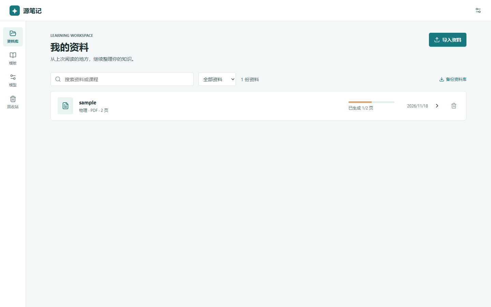
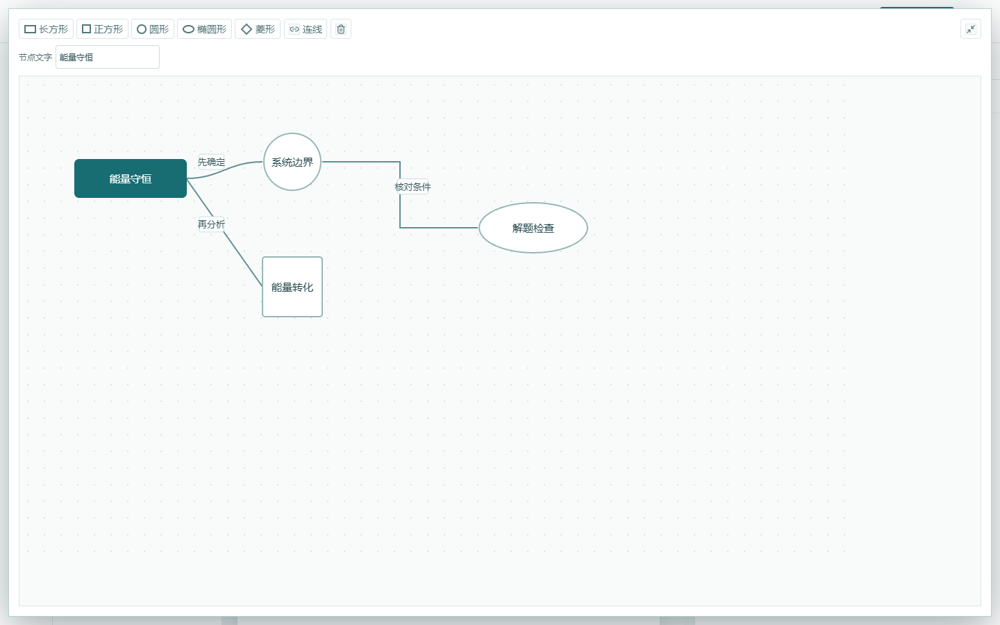

源笔记是一款面向学生的资料阅读和笔记工具。你可以把课件或讲义放进资料库，在原文旁写下理解，给重点添加批注，再从笔记跳回对应的原文。智能整理是可选功能，只有你自行接入模型后才会使用。

> 当前可下载 Windows 预览安装包和 Android 离线测试 APK。网页端可以在自己的电脑上运行，但尚无公开访问网址；iOS 安装包尚未提供。
> Windows 0.1.4 和 Android 0.2.5 已包含批量导入与资料文件夹功能。更新前建议备份资料库，Android 请直接覆盖安装。

## 选择适合自己的版本

| 设备 | 获取方式 | 导入资料 | 需要联网的功能 |
| --- | --- | --- | --- |
| Windows 电脑 | [下载 Windows 安装包 0.1.4](https://github.com/kaituozher11-png/yuan-notes/releases/download/preview-2026-11-23/YuanNotes-Windows-Setup-0.1.4.exe) | PDF、PPT/PPTX、Word/DOCX；需安装文档转换工具 | 智能生成笔记 |
| Android 手机或平板 | [下载 Android APK 0.2.5](https://github.com/kaituozher11-png/yuan-notes/releases/download/preview-2026-11-23/YuanNotes-Android-offline-0.2.5.apk) | PDF，最大 100 MB | 智能生成笔记 |
| 本机网页版 | 按本文后面的“从源码运行”启动 | PDF、PPT/PPTX、Word/DOCX；需安装文档转换工具 | 智能生成笔记 |

Windows 和 Android 是独立的本地资料库，目前不会自动同步。

## 在 Windows 上安装

1. 打开上方下载链接，保存 `YuanNotes-Windows-Setup-0.1.4.exe` 并运行安装。从开始菜单打开“源笔记”。这是未签名的预览安装包，Windows 可能显示来源提示。
2. 若要导入 PDF，电脑需要有 Poppler 的 `pdfinfo.exe`、`pdftotext.exe` 和 `pdftoppm.exe`。可从 [Poppler for Windows 发布页](https://github.com/oschwartz10612/poppler-windows/releases)取得 Windows 版本；解压后把包含这三个程序的目录加入 Windows 用户环境变量 `Path`，再重新打开源笔记。该 Windows 发行版由第三方维护。
3. 若要导入 PPT/PPTX，请安装 [LibreOffice](https://www.libreoffice.org/download/download-libreoffice/)。Word/DOCX 可由 LibreOffice 转换；装有 Microsoft Word 的 Windows 电脑也会优先尝试使用 Word。复杂公式、页码或图片转换后请检查预览，必要时先将原文件另存为 PDF 再导入。

安装包没有内置上述转换软件。缺少工具时，源笔记会提示导入失败或无法生成完整预览；补装后重新启动应用再试。

## 在 Android 上安装

1. 在手机或平板打开 [APK 下载链接](https://github.com/kaituozher11-png/yuan-notes/releases/download/preview-2026-11-23/YuanNotes-Android-offline-0.2.5.apk)，下载完成后点击文件安装。若系统要求允许浏览器或文件管理器“安装未知应用”，请按系统提示授权此次安装。
2. 打开“源笔记”即可进入资料库。无需连接电脑，也无需连接同一个 Wi-Fi。资料和笔记保存在手机或平板本地。
3. Android 版可直接导入 100 MB 以内的 PDF。Word 和 PPT 请先在电脑上转成 PDF，再传到手机导入。断网时可以继续读资料、写笔记；智能生成需要联网。

升级或卸载前先在资料库点击“备份资料库”保存 ZIP。清除应用数据或卸载应用可能删除设备内的资料。

## 五步完成第一份笔记

1. **导入资料**：在“资料库”点击“导入资料”，可一次选择多个文件，按需填写课程名称并选择目标文件夹。导入后点资料标题打开。
2. **阅读原文**：用页码导航、上一页和下一页切换内容；放大、缩小以适合屏幕。可选择原文文字并复制。
3. **打开笔记**：点击右上角“笔记”显示侧栏，再点击笔记栏的加号创建个人笔记页。选择模板后输入标题和内容。
4. **关联原文**：在原文选中文字，或点击“框选”后拖出区域，再点关联按钮连接当前笔记。点击关联内容可回看原文位置，也可以添加批注。
5. **保存副本**：回到资料库点击“备份资料库”，把原件、预览和笔记保存为 ZIP；需要单独分享笔记时，在文档页面点击“导出笔记”获得 HTML 文件。



资料库可以新建文件夹。进入文件夹后点击“导入资料”，新资料会默认放在当前文件夹；导入窗口也能新建并选择文件夹。每份资料右侧的下拉框可将它移到其他文件夹或根目录。删除文件夹前需先移出其中的资料；删除文件夹不会删除笔记。批量导入逐份处理，某份失败时已成功的资料会保留，窗口会列出失败原因。Android 离线版一次可选多个 PDF；网页版和 Windows 版可混选 PDF、Word、PPT。

## 原文和笔记怎么一起看

打开资料后，左侧的页面导航按原文页码列出笔记。点击“原文”可以集中阅读原件；点击“笔记”会在旁边打开笔记栏。电脑上可拖动两栏之间的分隔线调整宽度，笔记栏也可以最大化。手机或平板上界面会根据屏幕宽度调整。


个人笔记和智能笔记分开保存。你可以新建多个补充页，在同一个编辑区组合文字、公式和图片，粘贴图片后调整尺寸和位置。手写区适合画图或推导；思维导图用独立画布整理概念关系。笔记可复制、排序、删除，并可从回收站恢复。


## 给原文加标记和批注

原文工具栏的画笔按钮可打开画笔、荧光笔、橡皮擦和便利贴。便利贴有“单个”和“批量”两种放置方式，可拖动位置；隐藏后只保留小标记，点击标记可重新展开。

先把笔记与原文页、文字或框选区域关联，再为这个关联添加批注。批注可以包含文字、公式或图片；把鼠标移到关联位置附近可查看批注。框选区域可在保存前调整位置和大小。


## 可选的智能笔记

源笔记不附带模型账号或免费额度。要使用“生成笔记”，先从左侧打开“模型”：

1. 填写连接名称，从“预设模型”选择服务商和模型，或手动填写模型名称与接口地址。选择预设后，接口地址会自动填入；请核对它与你的服务商账号一致。
2. 输入自己的 API 密钥和至少 8 个字符的保护口令。仅当所选模型确实支持页面图片时，才勾选“模型可处理页面图片”。点击“保存连接”，再点击“测试连接与格式”。测试可能产生少量服务商费用。
3. 回到资料，点击“生成笔记”，选“当前页”“指定页”或“整份文档”。选择“课件笔记生成”或“论文笔记生成”预设；可直接修改、删除、添加或调整标题顺序，填写可选的“补充生成要求”。选择已保存的模型连接，必要时输入保护口令解锁，再开始生成。页面文字、所设标题、补充要求及可选的页面图片会发送给你选择的模型服务商。

两个预设各有现成的标题清单；改过的标题和补充要求会在当前设备保存，切换预设会重新载入该预设的标题。生成后进入“修改内容”状态，还可以直接修改自定义区块的标题和正文。生成结果可能有误，应对照原文核对。重新生成已有智能笔记时，先预览新旧内容再决定是否替换；个人补充不会因此被覆盖。Android 断网时点击生成会显示“无法生成智能笔记，请联网”。

## 模板 思维导图与整理

“模板”页面可调整笔记区块、顺序、强调色和纸张样式。新建笔记页时选择模板即可使用。思维导图可放置不同形状的节点、自由连接节点，并在连线上写说明。



资料库可按课程或关键词查找资料，筛选未生成完的资料或已有个人笔记的资料。误删的资料和笔记可从“回收站”恢复。


## 备份与常见问题

- **资料存在哪里**：Windows 安装版保存在应用的本地用户数据目录；Android 保存在应用本地数据中；从源码运行的本机网页版默认保存在项目的 `data/` 目录。它们目前不会自动同步。
- **如何备份**：在资料库点击“备份资料库”下载 ZIP。备份包含资料、预览、图片和笔记，不包含模型 API 密钥。Android 有“恢复备份”入口；恢复会替换手机内现有资料，先备份当前内容。其他版本当前没有同样的界面恢复入口。
- **为什么 Word 或 PPT 无法导入**：Android 只能直接导入 PDF；Windows 和本机网页版需要安装 LibreOffice，Windows 的 Word 文档也可使用本机 Microsoft Word。复杂文档建议先转为 PDF 并检查页码、公式和图片。
- **为什么智能笔记无法生成**：检查网络、模型接口地址、模型名称、API 密钥、可用额度及所选模型能力。断网时可继续手动记笔记。
- **为什么 GitHub 页面打不开软件**：GitHub 提供源代码和安装包，目前没有公开的在线网页版。

## 从源码运行本机网页版

这一步适合希望在自己电脑上运行网页端的用户。先准备 Node.js 24+、LibreOffice 和 Poppler 命令行工具，然后在终端运行：

```powershell
git clone https://github.com/kaituozher11-png/yuan-notes.git
cd yuan-notes
npm ci
npm run build
npm start
```

在同一台电脑的浏览器打开 `http://127.0.0.1:4174/`。关闭服务后网页不可用。默认本机服务只供自己使用，不要直接公开到互联网。开发者可运行 `npm test` 检查自动测试。

源笔记源码和测试安装包见 [GitHub 项目页](https://github.com/kaituozher11-png/yuan-notes)。本指南对应 2026 年 11 月的预览版本；功能和安装包仍在完善，Android 0.2.5 尚未完成实体手机和平板复测。
