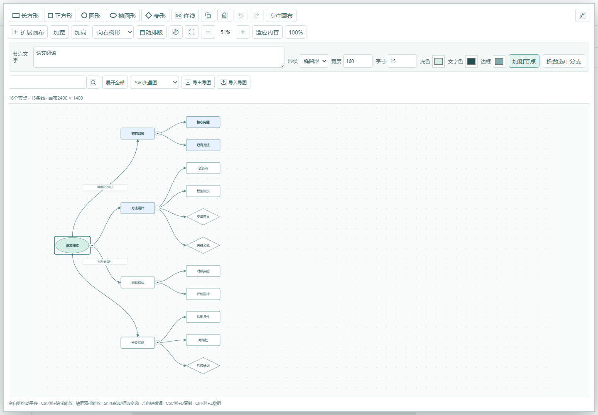
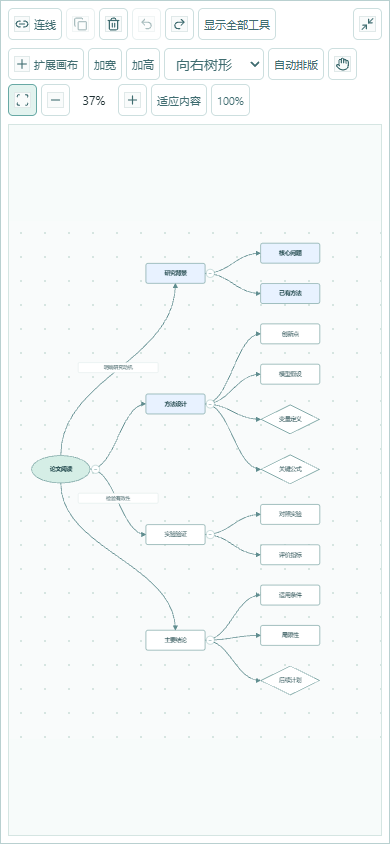

# 思维导图使用指南

适用于 Windows 0.3.2、Android 0.4.2-offline 和对应网页版。

## 打开与扩展

在个人笔记中插入“思维导图”，它使用独立画布，与文字、公式、图片编辑区分开。点击右上角的全屏图标扩大编辑空间。“专注画布”会隐藏节点属性和文件工具，手机、平板操作时可腾出更多面积；再次点击“显示全部工具”即可恢复。

“扩展画布”每次加宽 800、加高 600；也可以单独加宽或加高。扩展保留节点原位置，不会缩小文字。画布上限为 32000 × 32000，一图最多 500 节点。大图可以用 100% 查看细节，再拖动空白处或滚动浏览。“适应内容”用于全图概览，节点很多时会缩小显示。

## 编辑与整理

- 点击或拖入长方形、正方形、圆形、椭圆形、菱形节点；选中后修改文字、宽度、字号、颜色和粗体。长文字会自动换行并增高节点。
- 点击“连线”，再选起点和终点；节点可以自由连接。点击连线可编辑说明文字、曲线/直线/折线、颜色、粗细、箭头和虚线；删除按钮删除当前选择的线。
- “自动排版”提供两侧紧凑、向右树形、向下树形和网格整理。间距按每个父节点的实际尺寸计算，两侧分摊分支。“紧凑美化”会重新设置默认层级字号和分支配色，保留文字、关系和节点形状，操作可以撤销。循环连接、多个起点和共享节点也可以整理；保留文字、样式和连接关系。布局超限会提示，原图保留。
- Shift 点选或使用框选工具选择多个节点，可以成组移动、复制或修改样式；复制会带上所选节点之间的连接线。
- 折叠分支减少屏幕内容，展开后恢复；共享子节点若有其他可见路径仍会显示。搜索可以定位可见节点，找不到时先“展开全部”。
- Ctrl/⌘+Z 撤销、Ctrl/⌘+Y 或 Shift+Ctrl/⌘+Z 重做；Ctrl/⌘+D 复制，方向键微调，Shift+方向键每次移动更多。导图历史最多 50 步，刷新后不保留操作历史，已保存内容保留。

触屏可用双指缩放，电脑可用 Ctrl/⌘+滚轮缩放；单指拖动空白处平移。手掌图标切换拖动画布模式。

## 保存与导出

编辑沿用笔记自动保存。SVG 适合保持清晰，PNG 方便插入图片，JSON 用于继续编辑。导出包含全部节点和折叠内容，不只导出屏幕可见区域。PNG 为控制设备内存会限制图片像素，特别大的导图优先用 SVG。

导入仅接受本软件导出的 JSON 格式及兼容结构，最大 2 MB、500 节点、1500 条连线。导入前会确认替换，取消不改变当前图，导入后可以撤销。Xmind、MindMeister 等原生格式不在当前支持范围。

## 让助手操作

选择并解锁自己的模型连接后，可以输入：

- “扩展当前思维导图，并向下自动排版。”
- “给方法节点加一个圆形的实验验证节点，连接线上标注验证，并加箭头。”
- “只把结论节点改成黄色，字号 20，其他内容保留。”
- “展开全部分支，导出 JSON。”

助手先读取笔记，再按编号修改，布局和已有图的编辑会显示确认。取消即停止；若你在此期间又修改了笔记，会要求重新读取，避免旧内容覆盖新内容。导出需点击对话中的下载按钮。助手需要联网和自行提供的 API；离线阅读和手动编辑不需要模型服务。
