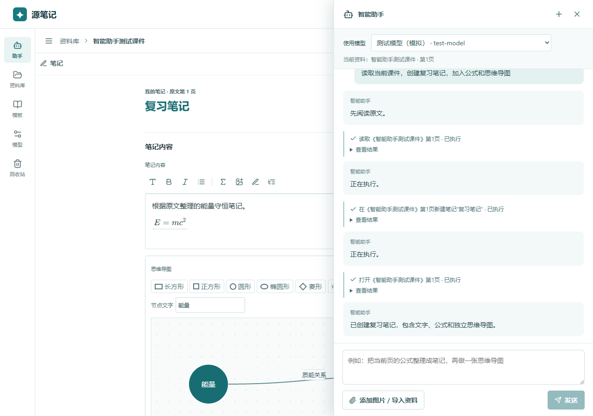
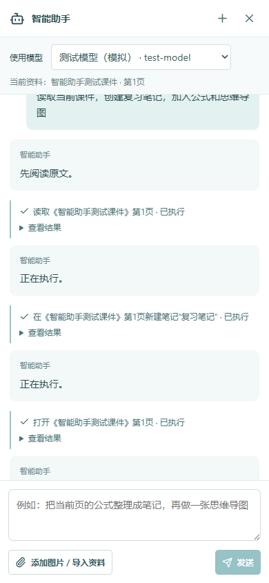

# 源笔记智能助手

智能助手从 Windows 0.2.0、Android 0.3.0 和本仓库对应网页版开始提供。点击顶部机器人按钮或左侧“助手”，用一句话提出要求，助手会查找当前资料、决定下一步并调用软件功能。每一步都有执行记录，可以展开查看结果，也可以随时停止。

## 开始使用

1. 到“模型”保存自己的模型接口、模型名称和 API 密钥。仍使用原有 Chat Completions 连接。
2. 打开“助手”，选择已保存的模型，输入保护口令解锁。密钥和口令不要写在聊天指令里。
3. 如果要求涉及“当前页”或“这篇论文”，先打开相应资料和页码；如果涉及一份已有笔记，先选中它，或在指令里说出笔记标题。
4. 输入指令，点击“发送”。Enter 发送，Shift+Enter 换行。模型读取的资料和执行结果会作为后续步骤的依据。
5. 完成后可继续提出要求，例如“给刚才的笔记再加一个公式”或“撤销刚才的修改”。新建对话按钮清空本次对话上下文。

## 可以让助手做什么

| 功能 | 可以直接输入的例子 |
| --- | --- |
| 查找、打开、定位 | “找到信号处理课件，打开第 8 页”“搜索提到能量守恒的笔记” |
| 阅读与问答 | “解释当前页的推导，并指出哪些信息需要再核对” |
| 智能笔记 | “用论文模板生成第 2 至 4 页笔记，标题改为研究问题、方法、结论” |
| 重新生成 | “重新整理当前页智能笔记，重点解释公式”——准备新旧草稿后确认替换 |
| 个人笔记与公式 | “在当前页创建复习笔记，把文字和这两个公式放在同一个编辑区” |
| 图片 | 点击助手中的“添加图片 / 导入资料”上传图片，再说“把这张图片放到当前笔记，宽度 40%，右对齐” |
| 思维导图 | “把当前笔记整理成思维导图，用圆形和长方形节点，给连接线加说明” |
| 手写 | “给当前笔记添加一个手写区”“把手写区高度增加到 900”——也可以打开手写工具亲自书写 |
| 笔记管理 | “复制这份笔记”“把这页笔记按复习顺序排列”“删除第二个内容区块” |
| 原文关联和批注 | 先选择原文文字或框选区域，再说“将选区关联到当前笔记，批注说明这条公式” |
| 原文画笔 | “在页面上方加一条荧光笔线”——精确位置可用页面比例描述；也可说“打开画笔工具”后自己标记 |
| 便利贴 | “在当前页右上角放一张便利贴，写上明天复习”“隐藏这张便利贴”“把它移到左下角” |
| 文件夹与资料 | “新建雷达论文文件夹，把这篇论文移进去”“修改这份资料的课程名称” |
| 模板 | “创建一个模板，包含背景、方法、推导、疑问四个区块，使用方格纸” |
| 导入、导出与备份 | “打开批量导入”“导出当前资料的笔记”“备份我的资料库” |
| 阅读界面 | “只显示原文”“最大化笔记”“将缩放设为 160%，收起页面导航” |
| 复制与历史 | “复制选中的文字”“撤销刚才对笔记的修改”“重做上一次修改” |

文字、公式、图片仍放在原有的统一笔记编辑区；思维导图继续使用独立画布。助手修改已有笔记前会检查是否有新的编辑，避免用旧内容覆盖刚保存的内容。

## 哪些操作需要你继续完成

选择电脑或手机上的文件、输入模型密钥和保护口令、点击下载或复制、亲手绘图等交互，助手会提供按钮或打开现有入口。打开入口会明确提示“需要在界面继续操作”，不代表已经导入、恢复或完成手写。Android 支持 PDF 直接导入；Word/PPT 仍需先转成 PDF。当前网页版提供备份下载，恢复备份沿用 Android 离线版已有入口。

移入回收站、删除区块或模板、替换已有智能笔记、修改已有原文标记等操作，会展示具体对象和修改内容供确认；取消后本次任务停止。已经完成的其他步骤仍保留。

## 联网与任务范围

助手需要联网和自行配置的大模型 API。指令、资料目录，以及任务执行中读取的笔记或原文会发送给所选服务商；API 密钥用于该服务商的请求认证，不放入聊天内容。调用可能产生服务商费用。未联网时，原有本地阅读和编辑功能仍可使用。

每个请求最多自动执行 12 步，每次生成 1 至 10 页智能笔记。长文档可以分批继续；生成时已有智能笔记会跳过，需要替换时请明确提出“重新生成”，然后查看对比草稿。工具调用失败会显示原因，连续失败时停止。停止正在生成的请求后，已完成的操作保留；安卓系统已发出的联网请求可能仍由服务商处理，但结果不会继续写入笔记。

助手没有永久删除资料、执行任意系统命令或控制其他软件的功能。扫描件没有可提取文字时，原文问答会说明限制；智能笔记可使用支持页面图片的模型。图片附件可用于插入和排版，当前助手对话不会直接读取图片中的视觉内容。

本版已通过自动测试及模拟模型的网页、离线页面流程测试。不同实际模型对中文意图、复杂编辑和长任务的表现仍需要实际使用验证；未接入你的真实密钥进行收费模型测试。
