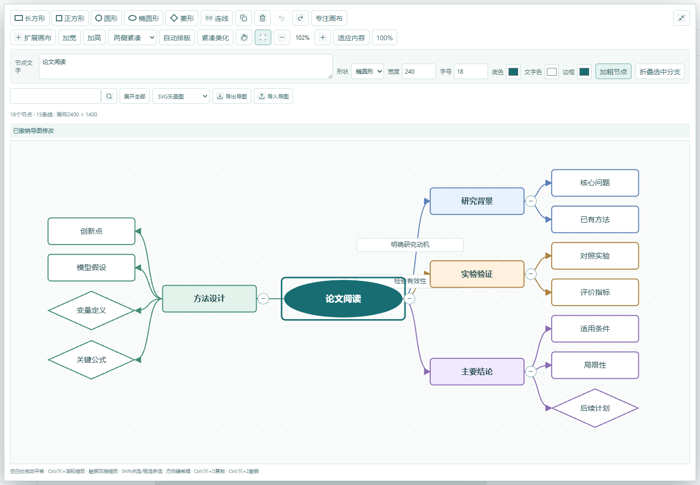
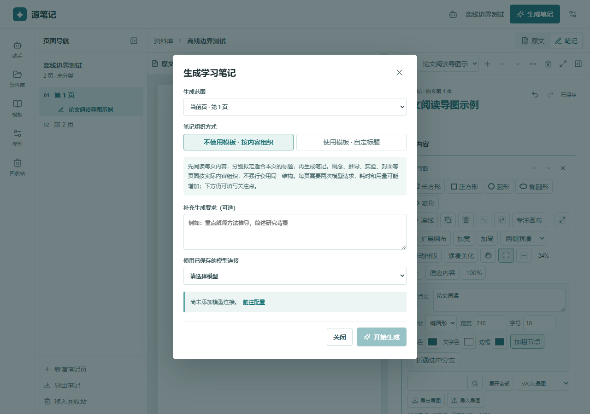

# 自适应笔记与紧凑导图验收

日期：2026-11-28。版本：Windows / web 0.3.1、Android 0.4.1-offline（versionCode 12）。

## 问题与修改

1. 部分助手生成图直接使用模型给出的超大坐标；原有树布局还按整层最宽节点留空，分支多时纵向尺寸很大。现在新图统一使用两侧紧凑布局，逐个父节点计算层间距、分支按高度平衡，默认分支配色及层级字号。旧图可用“紧凑美化”，保留文字、节点形状和关系，可撤销；不会批量改写用户已有资料。补充修复视区居中、缩放和平移后定位，以及短距离连线的方向选择。
2. 智能生成以前始终向每一页传同一组标题。现在所有生成范围可选“不使用模板 · 按内容组织”和“使用模板 · 自定标题”。前者每页先提取文字及可用图片，请求模型规划本页的 1～8 个具体标题，再向同一模型提交该页原文和提纲生成正文；不复用其他页的提纲。后者保留原论文/课件标题、自定义标题、顺序和补充要求。首次使用默认按内容组织，旧配置保留模板选择，之后保存用户选择。
3. 助手协议与工具支持两种模式；未指定模板/标题时采用按内容组织。导图规划指引要求先读指定范围，围绕知识逻辑组织中心、主分支和短语，避免机械按每页生成同级分支或塞入整段原文；新图自动紧凑布局，不依赖模型夸大的位置坐标。已有图可通过配置工具美化。

## 验证

95 项自动测试通过，生产构建通过。保留旧测试并新增：

- 概念、推导、实验和封面的独立标题规划，输出数量不同，保留公式并去除重复区块标题。
- 固定模板只调用正文生成，保留用户标题；自动模式不受隐藏的无效固定标题影响。
- 空/重复/过长/超量提纲、非法模式、空白正文、输出截断、提纲后取消均阻止保存，不退回僵硬模板。
- 实际模型适配器连接模拟服务，检查两次请求使用同页原文及图片；无效提纲不进入正文调用。
- 实际 API 中完成 PDF 提取、生成、预览和确认替换；失败无半成品、确认前原内容不变、个人补充保留。
- 助手调用的模式与提纲传递、按内容预览，以及新增导图紧凑坐标；原多步任务、恢复、去重和全篇阅读保护仍通过。
- 两侧布局的密集 31/80 节点、循环、共享后继、独立组件、长文字和样式恢复；不重叠，原对象不变。

浏览器与离线场景：

- 用隔离副本检查实际 51 节点、50 条连线导图，内容范围由约 5220×13094 整理为约 1276×2431，知识文字与连线保留。
- 指定第 1～3 页生成分别得到 1、3、2 个标题；10 页整份生成各自进行提纲/正文两次调用，没有复用固定模板。这里使用模拟模型的不同响应验证流程，不是实际模型内容质量评价。
- 模板切换显示/隐藏标题编辑区；重新生成对比显示旧的自适应标题与新的固定六段，确认前不替换。
- 手机 390px 下无页面横向溢出；修正生成弹窗底栏遮住解锁按钮的滚动问题。
- Android 离线调用适配在原生联网桥模拟下完成封面与推导两种标题结构；断网时不调用模型，提示联网。
- 手动框选、成组拖动、撤销、自由连接和撤销连接通过；真实浏览器双指事件缩放 35%→54%。离线图的 SVG/PNG/JSON 下载桥、保存和 ZIP 恢复仍通过。

## 费用与验证边界

按内容组织通常每页两次请求，费用和耗时可能增加，界面已提示。软件先规划再生成，不展示模型内部推理过程；相似页面允许合理使用相似结构，不以强制不同标题制造差异。模型仍可能理解不佳，提纲和笔记需要核对，不能保证任意模型对任何资料都达到理想效果。

本次没有使用真实收费 API 密钥进行语义质量验收，也没有实体 Android 手机/平板验证。浏览器尺寸、触摸事件和原生桥模拟不替代真机。超大图全览仍需缩小，可用 100% 查看细节、折叠分支或分图；紧凑布局不保证所有自由连线无交叉。此前 Word/PDF 转换、存储和公开部署的限制仍然适用。

## 打包核验

Windows 安装包、Android APK 已重新构建，两个包内的 94 个网页资源各自与生产构建逐字节一致。打包后的 Windows 服务实际启动并接受助手工具；客户端实际打开资料及生成选项、切换两种模式，没有浏览器错误。APK 签名验证通过且与旧测试版本一致。尚未进行全新系统安装及实体 Android 设备复测。
