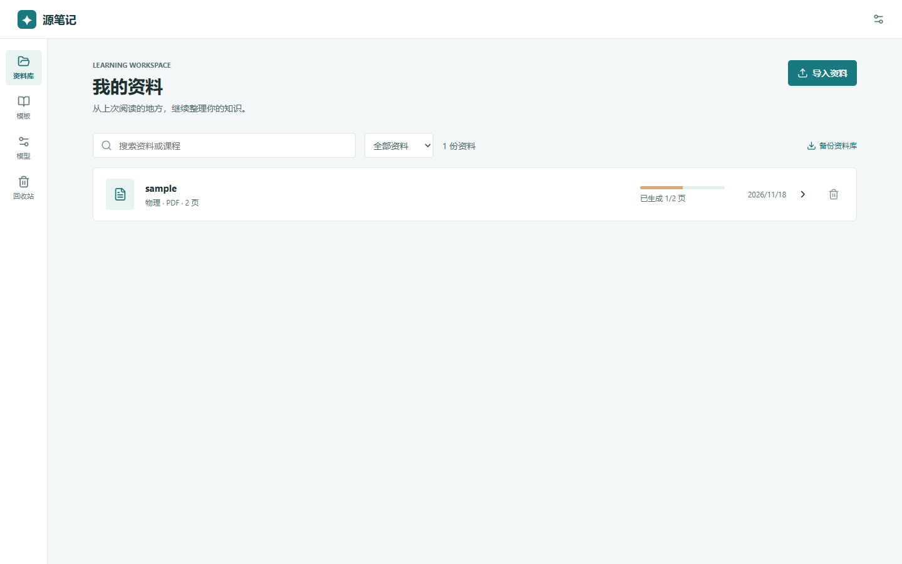
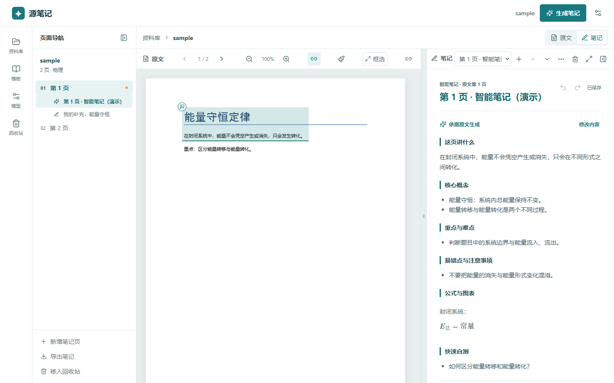
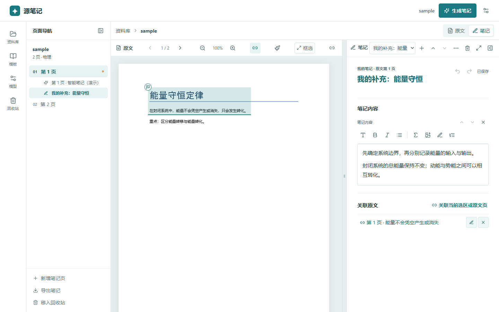
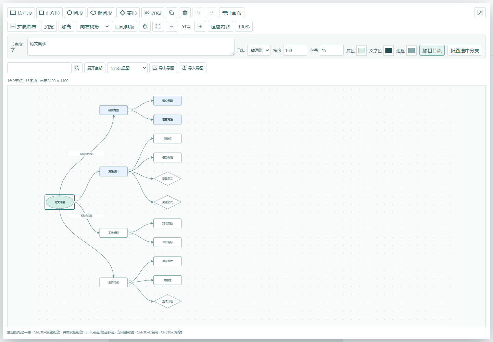
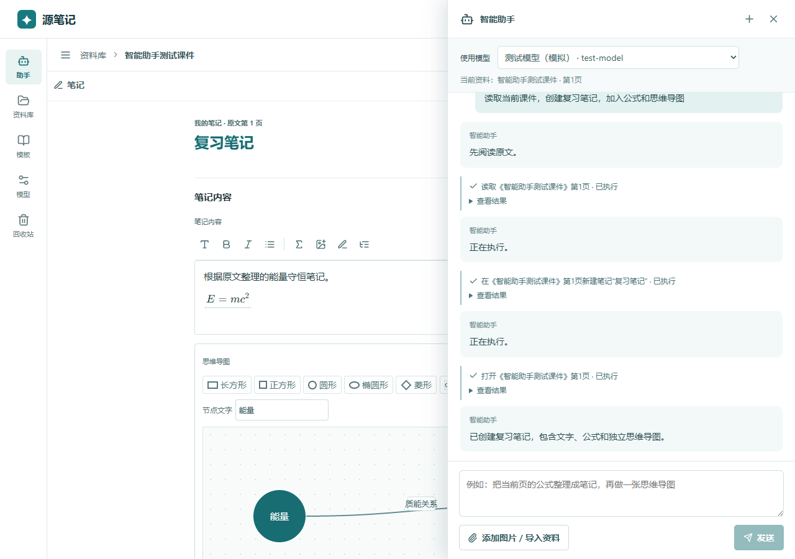

# 源笔记项目介绍

源笔记（Yuan Notes）是一款公开源码的学习资料与笔记应用。它将“阅读资料 → 记录理解 → 关联出处 → 梳理知识 → 导出与备份”放在同一个工作区，适合课程学习、论文阅读、考试复习和自主学习。

当前提供 Windows 0.3.3 安装包、Android 0.4.3-offline APK，以及可自行运行的网页源码。项目尚无官方公共在线网址和 iOS 安装包。

[下载和安装](../../README.md#下载与安装) · [完整功能](../../README.md#功能介绍) · [使用教程](../使用指南.md) · [常见问题](../常见问题与注意事项.md)

## 为什么做这个项目

阅读课件和论文时，笔记往往散落在不同文件里：公式不方便输入，截取图片后忘记出处，长文笔记和原文来回查找也容易中断。源笔记把原文页码、选中文字或框选区域与笔记连接，方便在学习过程中回到依据并补充自己的理解。

智能生成功能帮助整理页面，但个人笔记、手写和知识图仍由使用者掌握。AI 是可选能力，不是阅读和编辑的前提，也不替代对原文的核对。

## 面向谁

| 用户 | 使用方式 |
| --- | --- |
| 上课和复习的学生 | 批量导入课程资料、按文件夹整理，记录重点、易错点与自测问题 |
| 阅读论文的人 | 按研究问题、方法、公式、实验和局限整理笔记，回链对应页码与段落 |
| 习惯手写或画图的人 | 使用手写区、原文荧光笔、便利贴和独立思维导图 |
| 希望使用自己的模型的人 | 保存自有 API 连接，自定义生成标题，通过助手执行学习整理操作 |
| 希望自主管理数据的人 | 在电脑/Android 本地保存，或自行运行网页服务并备份 |

## 一个典型学习过程

1. 把多份资料导入一个课程或论文文件夹。
2. 打开资料，边读原文边展开笔记侧栏；需要时最大化其中一栏。
3. 在同一个编辑区记录文字、公式和图片，补充推导或手写图示。
4. 关联原文、添加混合批注，或用画笔和可隐藏便利贴标出疑问。
5. 用独立思维导图串起概念和方法，自动排版后再细调。
6. 可选接入模型按自定义标题生成笔记，或让助手整理文件夹、补充笔记、编辑导图和导出。
7. 导出 HTML 分享笔记，或保存 ZIP 资料库副本。

## 界面展示

资料库负责导入、文件夹、搜索、筛选、删除恢复和备份；不是只有单个文件的演示页面。

原文与笔记可一起看，也可切换单独显示。个人补充和智能笔记分开保存，可以追溯到原文。

文字、数学公式和图片可共同编辑，手写和思维导图提供额外记录空间。

导图可扩展、全屏、专注，支持自由连线、多选、自动布局和完整导出。

助手使用用户自己的模型，通过具名操作逐步完成任务，显示执行结果并在需要时等待确认。

## 使用前了解

阅读和手动笔记不需要模型。AI 需要联网和自有 Chat Completions 兼容 API，服务商可能收费，相关资料会按任务发送给所选服务商。生成结果仍需人工核对。

Windows 文档处理需要外部 Poppler / Office 转换工具；Android 直接导入 PDF，Word/PPT 先转换。版本之间没有自动同步和实时协作。Android 恢复备份会替换当前资料库；模型密钥不在 ZIP 内。

安装包仍是预览/测试版，实体设备兼容、复杂文档转换和真实模型效果存在验证范围，见[当前验收记录](../自适应笔记与紧凑导图验收_2026-11-28.md)。

## 文档与归档

当前功能说明以[项目首页](../../README.md)和[使用指南](../使用指南.md)为准。目录中的 [PDF 项目介绍](源笔记项目介绍.pdf)和 [Word 项目介绍](源笔记项目介绍.docx)为早期静态介绍存档，未包含之后的全部更新，不应作为当前下载版本和功能清单依据。
